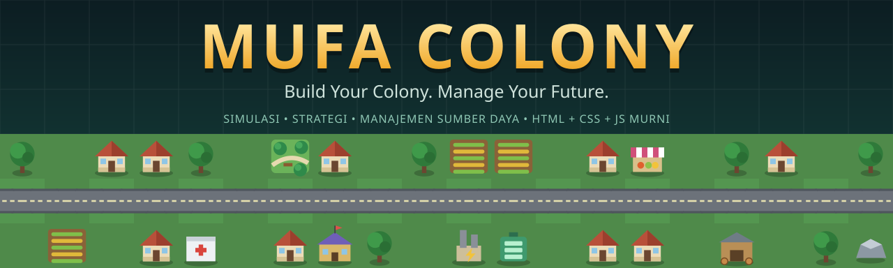
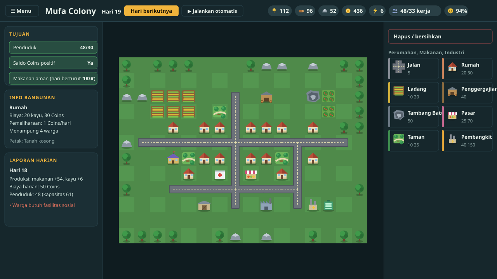

<div align="center">



### Bangun koloni. Kelola sumber daya. Hadapi tantangan yang berbeda di setiap mode.

[](https://github.com/faris-it/colony-game/actions/workflows/ci.yml)


## [▶ Mainkan sekarang](https://faris-it.github.io/colony-game/)

[Cara bermain](docs/HOW_TO_PLAY.md) · [Daftar mode](docs/MODES.md) · [Katalog bangunan](docs/BUILDINGS.md) · [Keseimbangan](docs/BALANCE.md) · [Pengembangan](docs/DEVELOPMENT.md)

</div>

---

**Mufa Colony** adalah game ke-3 dari katalog **Mufa Games**: simulasi, strategi, dan manajemen sumber daya yang berjalan langsung di browser desktop maupun mobile. Kamu memulai dari permukiman kecil dengan sumber daya terbatas, lalu membangun rumah, ladang, industri, energi, dan fasilitas umum sambil menjaga warga tetap kenyang, bekerja, dan bahagia.

Tidak ada framework, library, gambar, audio, font, atau backend. **Semua grafis digambar sendiri dengan SVG inline dan CSS.**

<div align="center">

<sub>Pratinjau dirender dari state permainan sungguhan memakai grafis bawaan game (bukan tangkapan layar browser).</sub>
</div>

## Sorotan

| | |
|---|---|
| **12 mode + Tutorial** | Classic, Speed Builder, Survival, Economic Empire, Green Colony, Disaster Response, Population Boom, Tiny Territory, Frontier Explorer, Energy Crisis, Endless Settlement, dan Campaign. Tiap mode mengubah tujuan, aturan, peta, dan kondisi menang atau kalah. |
| **Ekonomi yang saling terhubung** | Makanan, kayu, batu, Coins, energi, dan penduduk saling memengaruhi. Warga butuh makan, pekerjaan, rumah, dan fasilitas sosial. |
| **Statistik harian** | Klik sumber daya mana pun untuk melihat grafik dan tabel produksi, konsumsi, biaya bangun, dan stok dari hari ke hari. |
| **Mekanik khusus** | Kabut eksplorasi, bencana dan perbaikan, prioritas energi dan gangguan jaringan, skor lingkungan, jalan yang menyambung otomatis, peta prosedural, dan penjualan stok. |
| **Campaign 6 misi** | Tiap misi memperkenalkan satu mekanik dengan sumber daya awal, peta, dan target berbeda. |
| **Progres lokal** | 12 pencapaian, statistik, rekor per mode, simpan otomatis, dan Lanjutkan Permainan lewat `localStorage`. |
| **Mudah untuk pemula** | Mode Tutorial 12 langkah dengan tanda panah yang menunjuk tombol dan petak yang harus diklik. |
| **Diuji otomatis** | 74 pengujian (aturan, keseimbangan, dan smoke) berjalan di CI tanpa dependensi. |

## Mode permainan

| # | Mode | Tantangan utama | Menang |
|---|---|---|---|
| - | **Tutorial** | Belajar langkah demi langkah | Selesaikan 12 langkah |
| 1 | **Colony Classic** | Koloni stabil dari nol | 30 penduduk, kas positif, makanan aman 5 hari |
| 2 | **Speed Builder** | Hanya 30 hari | Skor 700 sebelum waktu habis |
| 3 | **Survival Colony** | Stok tipis, kayu dan batu alam bisa habis | Bertahan 60 hari |
| 4 | **Economic Empire** | Stok dijual otomatis, harga turun jika membanjiri pasar | 10.000 Coins dengan laba positif 10 hari |
| 5 | **Green Colony** | Industri merusak lingkungan | Kepuasan 80% dan lingkungan 85 selama 7 hari |
| 6 | **Disaster Response** | Mulai dengan bangunan rusak, badai dan kebakaran | Pulihkan bangunan vital dan bertahan 20 hari |
| 7 | **Population Boom** | Warga tumbuh cepat, pengangguran menurunkan kepuasan | 100 penduduk dengan kepuasan 75% |
| 8 | **Tiny Territory** | Peta 8x6, bangunan wajib menempel jalan | 20 penduduk, 80 makanan, 500 Coins |
| 9 | **Frontier Explorer** | Peta tertutup kabut, ekspedisi berbiaya | Temukan dan bangun di 3 lokasi khusus |
| 10 | **Energy Crisis** | Permintaan naik, gangguan jaringan | 15 hari energi stabil |
| 11 | **Endless Settlement** | Peta meluas, biaya naik, kekeringan | Tanpa akhir, kejar skor |
| 12 | **Colony Campaign** | 6 misi dengan mekanik berbeda | Selesaikan semua misi |

Detail aturan tiap mode ada di [docs/MODES.md](docs/MODES.md).

## Mulai bermain dalam 1 menit

1. Buka game, pilih **Tutorial** (disarankan untuk pemula).
2. Pilih bangunan di panel kanan, lalu klik tanah kosong di peta.
3. Tekan **Hari berikutnya**: warga makan, bangunan berproduksi, dan biaya dibayar.
4. Pantau **Tujuan**, **Laporan harian**, dan chip sumber daya di bagian atas. Klik chip untuk melihat statistik.

**Kontrol:** klik atau sentuh petak untuk membangun. Keyboard: panah menggerakkan kursor, `Enter` atau `Spasi` membangun, `Delete` menghapus, angka `1`-`9` memilih alat.

## Menjalankan sendiri

Tidak perlu instalasi. Pilih salah satu:

```bash
# 1. Langsung buka di browser
open index.html            # macOS (Windows: start index.html, Linux: xdg-open index.html)

# 2. Atau lewat server statis lokal
python3 -m http.server 8000   # lalu buka http://localhost:8000
```

Untuk dipublikasikan di GitHub Pages, ikuti [docs/GITHUB_SETUP.md](docs/GITHUB_SETUP.md).

## Teknologi

| Teknologi | Tanggung jawab |
|---|---|
| HTML5 | Struktur menu, panel, dan antarmuka |
| CSS3 (Grid) | Tata letak peta, panel, animasi, tema terang dan gelap |
| JavaScript murni | Simulasi ekonomi, penduduk, waktu, dan aturan mode |
| SVG inline | Semua grafis bangunan, ikon, dan jalan |
| `localStorage` | Progres, pengaturan, statistik, dan simpanan permainan |

Prinsip arsitektur: mesin simulasi hanya menghitung satu hari, bangunan didefinisikan sebagai **data terstruktur** (`data/buildings.js`), mode hanya menentukan kondisi awal, tujuan, dan menang atau kalah, dan renderer hanya menggambar tanpa mencampur perhitungan. Penjelasan lengkap ada di [docs/DEVELOPMENT.md](docs/DEVELOPMENT.md).

## Struktur proyek

```
colony-game/
├── index.html            # Titik masuk game
├── css/style.css         # Tata letak, peta, panel, tema
├── js/                   # Mesin: state, map, buildings, economy, population,
│                         #   simulation, events, scoring, renderer, ui, screens, store
├── data/                 # buildings.js (katalog bangunan), campaign-levels.js
├── modes/                # Satu file per mode (classic.js, survival.js, ...)
├── tests/                # Pengujian otomatis tanpa dependensi
├── tools/                # Generator gambar repository dan dokumentasi bangunan
├── docs/                 # Cara bermain, mode, bangunan, keseimbangan, pengembangan
├── assets/               # Banner, pratinjau, social preview (hanya untuk repository)
└── .github/              # CI, deploy GitHub Pages, template issue dan PR
```

## Pengujian

```bash
node tests/run.js        # atau: npm test   (butuh Node 18+, tanpa npm install)
```

Pengujian memuat game persis seperti di browser (urutan `<script>` dari `index.html`) pada DOM tiruan, lalu memeriksa:

- **Sistem pembangunan:** petak terisi, biaya, pengembalian 50%, batas peta, dan tidak ada sumber daya gratis dari bangun-hapus berulang.
- **Simulasi:** produksi dan konsumsi dihitung sekali per hari, penduduk tidak melebihi kapasitas.
- **Keseimbangan:** bot sederhana harus menang di tiap mode, dan pemain pasif tidak boleh menang.
- **Keadaan mustahil:** 45 permainan acak (angka tak valid, stok negatif, bangunan di wilayah tertutup).
- **Penyimpanan:** simpanan rusak atau tidak lengkap ditolak dengan aman.

Hasil dan catatan keseimbangan ada di [docs/BALANCE.md](docs/BALANCE.md).

## Di luar lingkup versi 1.0

Multiplayer, akun dan penyimpanan cloud, pasar ekonomi online, perang antarkoloni, sistem mod dan editor peta publik, serta sinkronisasi pencapaian lintas-game. Fitur-fitur ini tidak diperlukan untuk membuktikan bahwa game inti menarik dan berfungsi.

> Menghapus data browser akan menghapus progres karena penyimpanan hanya lokal.

## Kontribusi

Laporan bug dan masukan keseimbangan sangat membantu. Lihat [CONTRIBUTING.md](CONTRIBUTING.md) dan template issue di tab **Issues**.

## Lisensi

[MIT](LICENSE) © Mufa Games

<details>
<summary><b>English summary</b></summary>

**Mufa Colony** is a browser-based city/colony management game (simulation, strategy, resource management) built with plain HTML, CSS and JavaScript. No frameworks, no libraries, no external assets: every graphic is drawn with inline SVG and CSS. It ships with a 12-step tutorial, 12 game modes (Classic, Speed Builder, Survival, Economic Empire, Green Colony, Disaster Response, Population Boom, Tiny Territory, Frontier Explorer, Energy Crisis, Endless Settlement, and a 6-mission Campaign), 12 achievements, local saves, and an automated test suite (`node tests/run.js`). The UI is in Indonesian. Open `index.html` to play.

</details>
